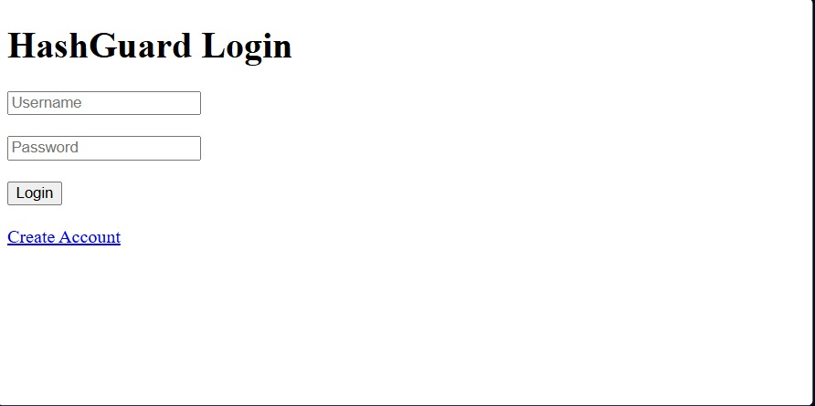
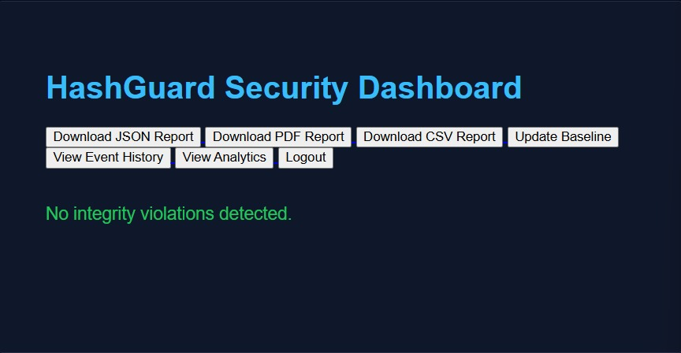
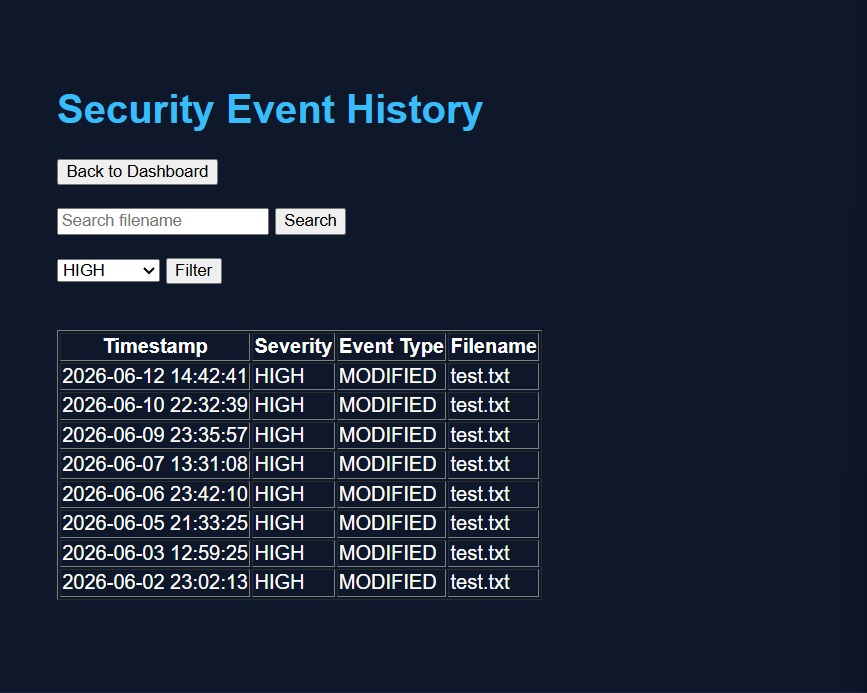
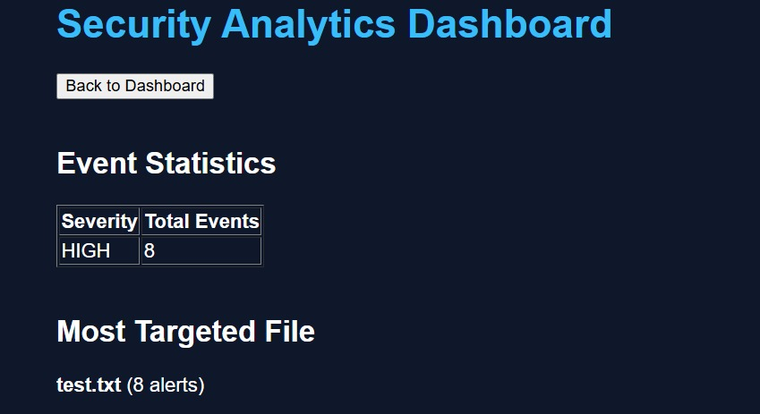
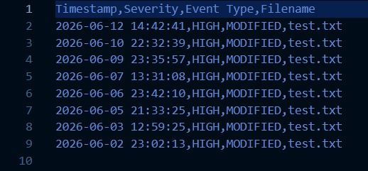
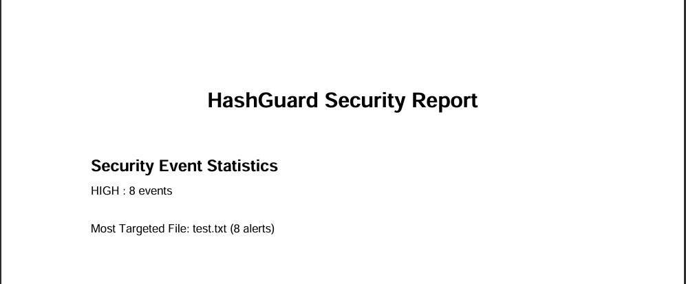

# HashGuard

HashGuard is a lightweight Flask-based file integrity monitoring application built to detect unauthorized changes to important files. It uses SHA-256 hashing, a baseline snapshot of trusted file states, and a SQLite-backed event log to identify modified, deleted, and newly added files.

The project helps users monitor sensitive files, track security events, review historical incidents, view dashboard analytics, and export reports in JSON, CSV, and PDF formats.

---

## Why this project exists

File integrity is critical for any environment that stores sensitive or business-critical data. A file can be changed without notice, and the impact may not be obvious until much later. Traditional storage systems often do not provide immediate detection or reporting for such events.

HashGuard solves this by:

- computing a cryptographic hash for files in a monitored folder
- storing a trusted baseline of hashes
- checking current files against that baseline
- logging suspicious activity in a database
- showing incidents through a web dashboard
- exporting report artifacts for audits and evidence
- alerting on severe events via email

---

## Main features

### File integrity monitoring

- SHA-256 hashing for every watched file
- baseline generation for trusted file states
- detection of modified files
- detection of deleted files
- detection of newly created files
- whitelist support for files that should be ignored

### Security event management

- SQLite database for storage of incidents
- event severity classification: LOW, MEDIUM, HIGH, CRITICAL
- search by filename
- filter by severity
- historical event viewing via the web application

### Analytics and reporting

- dashboard summary of alerts
- analytics page for event totals and targeted files
- JSON report export
- CSV export of the event log
- PDF report generation using ReportLab

### Authentication and access control

- user registration
- secure login
- password hashing using Werkzeug
- session-based access to protected routes

### Email notification

- critical alert email integration using SMTP
- environment-based configuration for sender and recipient addresses

---

## How it works

1. The user registers and signs in.
2. Files are placed into the `watched/` directory.
3. An authenticated user approves a baseline snapshot, which is saved in `baseline/hashes.json` with an HMAC-SHA256 signature. File keys are relative paths using `/`, including on Windows.
4. HashGuard verifies the baseline signature before comparing the current file state against it.
5. Any mismatch is identified as an integrity event.
6. Events are stored in `database/security.db` and written to the configured logs.
7. The dashboard reads event summaries from the database. An authenticated POST action runs scans through the shared scanner service.
8. JSON, CSV, and PDF downloads use the current database contents and do not trigger scans.

---

## Severity model

The monitoring logic classifies events as follows:

- HIGH: file has been modified
- CRITICAL: file has been deleted
- MEDIUM: new file detected

This is handled in `src/monitor.py`, which compares the current file set against the saved baseline.

---

## Tech stack

- Python 3
- Flask
- SQLite
- SHA-256 hashing
- Werkzeug
- HTML/CSS
- JSON
- ReportLab
- SMTP email delivery

---

## Project structure

```text
HashGuard/
├── app.py                     # Flask app and route definitions
├── wsgi.py                    # WSGI factory entrypoint
├── cli.py                     # One-shot CLI scanner
├── scheduler_main.py          # Locked standalone scheduler
├── .github/
│   └── workflows/
│       └── ci.yml              # GitHub Actions lint and test workflow
├── whitelist.json             # Files explicitly ignored during monitoring
├── requirements.txt           # Pinned Python dependencies
├── requirements-dev.txt       # Test and lint dependencies
├── pyproject.toml             # Ruff configuration
├── .env.example                # Environment variable template
├── README.md                  # Project documentation
├── baseline/
│   └── hashes.json           # Baseline of trusted file hashes
├── database/
│   └── security.db           # SQLite database for event and user storage
├── logs/
│   ├── security.log           # Human-readable security event log
│   └── security.jsonl         # Structured security event log
├── reports/
│   ├── security_report.json  # Latest report export
│   ├── security_events.csv   # CSV export
│   └── HashGuard_Security_Report.pdf
├── screenshots/
│   ├── analytics.jpeg        # Screenshot for analytics page
│   ├── csv-report.jpeg       # Screenshot for CSV report
│   ├── dashboard.jpeg        # Screenshot for dashboard
│   ├── history.jpeg          # Screenshot for history page
│   ├── login.jpeg            # Screenshot for login page
│   ├── pdf-report.jpeg       # Screenshot for PDF report
│   └── register.jpeg         # Screenshot for register page
├── src/
│   ├── config.py              # Environment parsing and validation
│   ├── extensions.py          # Shared Flask extensions
│   ├── event_status.py        # Canonical event statuses
│   ├── logging_setup.py       # Rotating logging configuration
│   ├── scan_settings.py       # Persisted interval and folder settings
│   ├── scheduler_service.py   # Scheduled scanner wrapper
│   ├── database.py           # SQLite utility functions for events and users
│   ├── email_alert.py        # SMTP email notification logic
│   ├── hasher.py             # SHA-256 hashing helper
│   ├── monitor.py            # Baseline creation and integrity checks
│   └── pdf_report.py        # PDF report generation
├── static/
│   └── style.css             # Styling for the web UI
├── templates/
│   ├── analytics.html        # Analytics dashboard template
│   ├── history.html          # Event history template
│   ├── index.html            # Main dashboard template
│   ├── login.html            # Login page template
│   ├── register.html         # Registration page template
│   └── settings.html         # Email alert settings template
├── watched/
│   ├── temp.txt              # Example ignored file
│   └── test.txt              # Example monitored file
├── tests/                     # Pytest regression suite
└── LICENSE                    # Project license
```

---

## Installation

### 1. Clone the repository

```bash
git clone https://github.com/Bigsnack7/HashGuard.git
cd HashGuard
```

### 2. Create a virtual environment (recommended)

```bash
python -m venv .venv
```

On Windows:

```bash
.venv\Scripts\activate
```

On macOS/Linux:

```bash
source .venv/bin/activate
```

### 3. Install dependencies

```bash
python -m pip install -r requirements.txt
Copy-Item .env.example .env  # PowerShell
```

Replace both example secrets in `.env` with distinct random values before startup.

---

## Running the application

From the project root:

```bash
python app.py
```

In a second terminal, start the integrity scheduler:

```bash
python scheduler_main.py
```

Run one scan from the shared CLI service:

```bash
python cli.py scan
```

Then open:

```text
http://127.0.0.1:5000/login
```

The scheduler is a separate process and is never started by importing `app`.
It acquires an OS-level lock in `LOGS_DIR`, refreshes persisted interval
settings, and reads the current watched folder before each shared-service scan.
Run exactly one `python scheduler_main.py` process alongside the web workers.
On Linux/macOS, install Gunicorn separately with `python -m pip install gunicorn`
and start the WSGI factory with `gunicorn wsgi:app`. Both processes must share
the same environment, database, logs directory, and watched files.

---

## Environment configuration

The project reads environment variables only in `src/config.py`. Copy
`.env.example` to `.env` and configure the listed paths, credentials, rate-limit
storage, and scan behavior there.

```env
HASHGUARD_ROOT=.
SECRET_KEY=replace_with_a_long_random_secret
BASELINE_HMAC_KEY=replace_with_a_long_random_secret
FLASK_DEBUG=false
DATABASE_PATH=database/security.db
LOGS_DIR=logs
REPORTS_DIR=reports
SCAN_ROOT=watched
WATCHED_FOLDER=.
BASELINE_FILE=baseline/hashes.json
WHITELIST_FILE=whitelist.json
SCAN_INTERVAL_SECONDS=300
RATELIMIT_STORAGE_URI=memory://
```

Notes:

- Configure `EMAIL_ADDRESS` and `EMAIL_PASSWORD` in `.env` for the account HashGuard sends from; for Gmail use an App Password. SMTP delivery uses STARTTLS; `SMTP_HOST` and `SMTP_PORT` default to `smtp.gmail.com` and `587`.
- Set the fallback recipient with `TO_EMAIL`, or configure it in the authenticated **Settings** page. The Settings value is stored in the local SQLite database and takes precedence over `TO_EMAIL`. Use **Send test email** on that page to verify delivery; test messages are limited to three per hour.
- `ALLOW_REGISTRATION` defaults to `false` and blocks `/register` unless the `users` table is empty, which allows the first account to be created.
- Set `ALLOW_REGISTRATION=true` to allow new registrations while the app is running.
- Set a unique, random `SECRET_KEY`; the app refuses to start if it is missing while `FLASK_DEBUG` is false. A temporary random key is generated only in debug mode.
- Replace the example value for both `SECRET_KEY` and `BASELINE_HMAC_KEY`; HashGuard rejects the example placeholder instead of using a publicly known signing key.
- At startup, HashGuard validates `BASELINE_HMAC_KEY`, `ALERT_COOLDOWN_SECONDS`, and the `whitelist.json` structure. Invalid required monitor configuration stops startup with a clear error instead of failing on the first scan.
- `FLASK_DEBUG` enables debug mode only when set to a truthy value. `SESSION_COOKIE_SECURE` controls whether the browser sends session cookies only over HTTPS; it defaults to `true` outside debug mode and `false` in debug mode. Set it to `false` only for local HTTP development, never for a production deployment.
- `BASELINE_HMAC_KEY` is required to sign and verify the integrity baseline. Back it up securely; without the original key, an existing signed baseline cannot be verified.
- Login and registration requests are rate limited (5/minute and 5/hour, respectively).
- `RATELIMIT_STORAGE_URI` configures Flask-Limiter storage and defaults to `memory://`. In-memory storage is single-process only; for multi-worker deployments, configure Redis (for example, `redis://localhost:6379/0`) and install the optional client with `python -m pip install -r requirements.txt -r requirements-redis.txt`.
- `SCAN_INTERVAL_SECONDS` sets the initial scheduler interval. Authenticated settings changes are persisted in SQLite and the scheduler reloads them without restart; its active folder is likewise read from the database for every scan.
- `SCAN_METADATA_CACHE` enables an optional per-process size/mtime cache for integrity scans. It defaults to disabled, so every scan hashes every file. Enabling it skips hashing when device, inode, size, and modification time match a prior scan; files changed while preserving those values can evade detection until a full-hash scan. Disable it for security-sensitive deployments or run periodic full-hash verification.
- `ALERT_COOLDOWN_SECONDS` sets how long an unchanged, unresolved alert waits before it can be recorded and emailed again (default: `3600`). Changed file state or a resolved-then-reappearing alert can notify immediately.
- Structured security events are appended as one JSON object per line to `logs/security.jsonl`, alongside `logs/security.log`. Set `SYSLOG_HOST` to enable optional UDP syslog forwarding; `SYSLOG_PORT` defaults to `514` and `SYSLOG_FACILITY` defaults to `user`.
- Both local event logs rotate at 10 MiB and retain five backups. Rotation is coordinated across processes; older entries are retained in the numbered backup files.
- For Gmail, use an app password rather than your normal account password.
- If email configuration is missing or invalid, alert delivery is skipped or reported in the server logs instead of stopping the scanner.
- Syslog forwarding is optional: invalid or unavailable syslog configuration is logged without preventing local event persistence or email alerts.
- Integrity checks fail visibly rather than reporting false deletions when the watched directory is missing or unreadable.
- Large baseline and integrity scans log progress every 100 successfully hashed files.

### Development commands

Install development tools and run the suite using:

```bash
python -m pip install -r requirements-dev.txt
```

Use `make setup`, `make run`, `make scheduler`, `make scan`, `make test`,
`make lint`, `make check`, or `make coverage`. On Windows, run the matching
Python commands directly if GNU Make is unavailable. Install the Ruff
pre-commit hook with `pre-commit install`.

GitHub Actions runs Ruff, pytest with coverage, `pip-audit`, and Bandit on
Python 3.11 and 3.12. Pip dependencies are cached from the requirements files;
the security scanners are installed in CI and are not application dependencies.

### Structured security logs

Each line in `logs/security.jsonl` has this schema:

```json
{
  "timestamp": "2026-10-30T07:35:12.123456Z",
  "event_type": "MODIFIED",
  "severity": "HIGH",
  "filename": "sub/config.json",
  "old_hash": "previous-sha256",
  "new_hash": "current-sha256",
  "host": "monitor-01",
  "user": "system"
}
```

`old_hash` or `new_hash` is `null` when it does not apply; automated scans use `system` as the user, while user-approved baseline updates record the signed-in username. For Microsoft Sentinel, forward the file with the Azure Monitor Agent using a custom text log data collection rule and parse each line as JSON in the table transformation. For Wazuh, configure `logs/security.jsonl` as a JSON-format local file in `localfile` so each JSON line is decoded into fields.

---

## Using the app

### Register an account

Navigate to `/register` and create a user.
With the default `ALLOW_REGISTRATION=false`, only the first account can be
created; additional registrations require the setting to be explicitly enabled.

### Log in

Use the login page and authenticate with your created account.

### Prepare monitored files

Place files under the configured watched folder. On a fresh install, sign in
and explicitly approve the current contents using **Approve baseline**; scans
never trust or create a missing baseline automatically.

```text
watched/
```

### Generate or refresh the baseline

Once files are in place, the baseline should be created. From the dashboard, use the update baseline action to save the current hash state.

### Check for alerts

The web dashboard does not scan on page load. Use **Run scan** for an
immediate check, or run the standalone scheduler process for recurring checks
at the configured interval. Both use the same scanner and saved scan settings.
Alerts are stored and displayed for:

- modified files
- deleted files
- newly added files

### Review event history

Visit the history page to view and update:

- timestamps
- severity
- event type
- filenames
- event status, actor, and status-change metadata

Combine filename, severity, and status filters to narrow results. Status changes record the signed-in username and a UTC timestamp.

### View analytics

The analytics page exposes database-backed aggregate statistics such as:

- total incidents by severity
- most targeted file
- open and critical event totals

The severity chart is rendered with local HTML and CSS and does not require an external chart service.

### Export reports

Available export options include:

- JSON security report
- CSV event log
- branded PDF security report with event totals, severity breakdown, triage metadata, and paginated event details

CSV text cells beginning with spreadsheet formula characters are prefixed to prevent the spreadsheet from evaluating them as formulas.

---

## App behavior and storage

### Database

The project uses SQLite with the file:

```text
database/security.db
```

Tables include:

- `security_events`: stores file integrity incidents
- `users`: stores account credentials and hashes

Security events have a workflow status: `open`, `acknowledged`, `resolved`, or `false_positive`. Existing databases are migrated on startup; existing events default to `open`. From the history page, authenticated users can change an event's status. The latest status change records the username and timestamp. Status is included in JSON, CSV, and PDF reports and can be filtered in event history. Baseline-update events use `baseline/hashes.json` as the filename, store the approving username in the actor field, and retain the change summary in event details; they are excluded from the most-targeted-file calculation.

### Baseline state

The baseline is stored in:

```text
baseline/hashes.json
```

This file contains the trusted SHA-256 values and their HMAC-SHA256 signature. The signature is calculated over canonical JSON using `BASELINE_HMAC_KEY`. Every integrity check validates it with a constant-time comparison before scanning files.

Set `BASELINE_HMAC_KEY` in `.env` to a long, random secret before starting the application. Keep it private and back it up securely; without it, baseline creation and verification fail with a clear error. If the baseline is modified or its signature is missing or invalid, HashGuard records a CRITICAL event, sends an email alert, and stops the scan. An authenticated user must use **Update Baseline** to approve a new baseline. Existing unsigned baselines also require this approval.

### Whitelist

The file:

```text
whitelist.json
```

contains ignored path patterns that should not be monitored. Paths use `/` separators. A plain name such as `temp.txt` matches only that file at the root of `watched/`, not `sub/temp.txt`. Patterns match path segments; `**` matches zero or more directories:

```json
{
  "ignored_files": [
    "temp.txt",
    "logs/**/*.tmp",
    "private/*"
  ]
}
```

The scanner walks `watched/` recursively. It skips symbolic links and logs a warning rather than following them. Existing signed flat baselines continue to work for root-level files. An old unsigned flat baseline is not trusted during scans; an authenticated user must use **Update Baseline** to approve and migrate it into the signed relative-path format.

---

## Screenshots

### Login page



### Register page


### Dashboard



### Event history



### Analytics



### CSV report



### PDF report



---

## Notes

This project is best suited for local security monitoring, small-scale file auditing, and learning about file integrity checks in a practical web application. It is not a full enterprise security suite and does not currently include features such as role-based authorization, multi-user RBAC, live real-time monitoring, distributed agents, or cloud-native deployment.

---

## Future improvements

Potential enhancements for the project include:

- real-time monitoring with WebSockets
- role-based access control
- multi-user administration
- file-size and extension rules
- richer historical trend visualizations
- per-recipient alert policies
- cloud or remote file monitoring support
- integration with SIEM or ticketing systems

---

## License

This project is licensed under the MIT License. See the `LICENSE` file for details.
